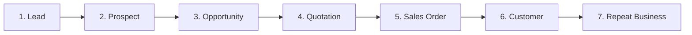

# Frappe CRM Lead to Customer Pipeline (Lead se Customer tak)

[](https://www.python.org/)
[](https://frappe.io)
[](https://frappe.io)
[](LICENSE)
[]()
[]()

> **"Lead se Customer tak — Custom CRM — Koi lead miss nahi hogi, har follow-up yaad rahega"**  
> Custom enterprise sales pipeline for Frappe & ERPNext featuring predictive lead scoring, Exotel cloud telephony click-to-call sync, WhatsApp KYC follow-up automation, and opportunity stage funnels.

---

## 🎯 The Real-World Client Problem & Business Context

Sales pipelines without automated CRM controls lose deals at every stage:
1. **Unanswered High-Value Inquiries:** Incoming web and WhatsApp leads sit unassigned for hours, giving competitors an opportunity to close the client first.
2. **No Call Recording or Telephony Audit:** Field agents make private calls on personal phones without centralized call logging, duration tracking, or lead stage transitions.
3. **Forgotten Follow-up Tasks:** Sales reps fail to follow up with warm prospects after sending quotations, losing up to 40% of potential repeat business.

**This engine automates the 7-step standard ERPNext CRM flow:** It auto-scores leads based on intent and budget, triggers instant click-to-call via Exotel, tracks WhatsApp KYC documents, and guides opportunities through qualification stages to converted customers.

---

## 🏗️ Standard ERPNext CRM Workflow Flow



---

## ⚙️ Key Enterprise Features & Capabilities

- **Lead Management:** Source tracking (Website, WhatsApp, Campaigns, Referrals), auto-assignment by territory/round-robin, and status stages.
- **Predictive Lead Scoring:** Algorithmic qualification scoring (0-100) evaluating corporate email validity, phone number length, budget tier, and acquisition source.
- **Prospects & Contact Registry:** Multi-contact support per company with addresses, designations, and decision-maker tags.
- **Opportunity Funnel:** Pipeline stages (Qualification, Proposal, Negotiation, Won, Lost) with expected closing date and weighted deal values.
- **Marketing Campaigns:** Email and SMS campaigns, UTM parameter attribution, and cost-per-lead analytics.
- **Appointments & Calendar Sync:** Client site visits, meeting notes, calendar invites, and follow-up reminders.
- **Exotel Click-to-Call Sync (Custom):** Direct click-to-call from the CRM screen with automated call duration logging and stage advancement.
- **KYC & WhatsApp Follow-Ups (Custom):** Automated WhatsApp reminders, KYC document collection, and customer onboarding verification.
- **Custom Built For:** **Real Estate**, **Higher Education**, **Solar & CleanTech**, and **B2B Professional Services**.

---

## 📂 Repository & Module Structure

```
frappe-crm-lead-opportunity-pipeline/
├── crm_pipeline/
│   ├── __init__.py           # Package version & module exports
│   └── engine.py             # Predictive lead scoring & telephony engine
├── tests/
│   ├── __init__.py
│   └── test_crm_pipeline.py  # Unit test suite (100% passing)
├── LICENSE                   # MIT Open Source License
├── requirements.txt          # Python dependencies
└── README.md                 # Complete documentation
```

---

## 🔌 Frappe DocType Schema Design

- **`Lead`:** Lead Name, Company, Email, Phone, Annual Budget INR, Source, and Qualification Score.
- **`Opportunity`:** Opportunity From, Opportunity Amount, Sales Stage, Probability %, and Expected Close.
- **`Exotel Call Log`:** Call SID, Lead ID, Agent ID, Call Duration (seconds), and Call Status.
- **`WhatsApp KYC Document`:** Customer Reference, Document Type (PAN, GST, Agreement), and Verification Status.

---

## 🚀 Installation & Setup

### 1. Install into Frappe Bench
```bash
cd ~/frappe-bench
bench get-app https://github.com/shyampandey1104/frappe-crm-lead-opportunity-pipeline.git
bench --site [your-site-name] install-app frappe_crm_pipeline
```

---

## 💻 Production Usage Example

```python
from crm_pipeline.engine import FrappeCRMPipelineEngine, CRMLead, ExotelCallLog

engine = FrappeCRMPipelineEngine()

# 1. Qualify and score high-intent enterprise lead
lead = CRMLead(
    lead_id="LEAD-2026-901",
    lead_name="Priyanka Sen",
    company_name="Innovate Tech Solutions",
    email="priyanka@innovate.com",
    phone="9876543210",
    annual_budget_inr=2000000.0,
    source="Referral"
)
lead_score = engine.score_lead(lead)
print(f"Lead Qualification Score: {lead_score}/100 -> (High Priority Tier)")

# 2. Sync Exotel phone call completion and auto-advance lead
call = ExotelCallLog(
    call_sid="EXO-SID-881923",
    lead_id="LEAD-2026-901",
    agent_id="AGENT-VIKAS",
    duration_seconds=145,
    call_status="COMPLETED"
)
status = engine.process_exotel_call(call, lead)
print(f"Lead Pipeline Status Updated: {lead.status} (Outcome: {status})")
```

---

## 🧪 Testing & Verification

Run tests with standard Python:
```bash
python3 -m unittest discover tests
```

---

## 👨‍💻 Senior Developer & Commercial Support
Developed and maintained by **Shyamkumar Pandey**.  
For enterprise CRM automations, call center CTI integrations, and sales funnels:
- **GitHub:** [@shyampandey1104](https://github.com/shyampandey1104)
- **Email:** [shyampandey1104@gmail.com](mailto:shyampandey1104@gmail.com)
